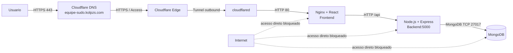

# Infraestrutura em Nuvem — Equipe SUDO

> 📄 **Documento da Entrega 01** — identificação da atividade, infraestrutura publicada, domínio/DNS,
> segurança, proxy reverso, testes e roadmap de adequação (serverless + redundância).
>
> A evolução com **observabilidade** (diagrama técnico, 8 painéis fundamentados, coleta de logs e
> evidências) está em **[`entrega-final-02/README.md`](entrega-final-02/README.md)**.

## 1. Identificacao da atividade

| Item | Informacao |
|---|---|
| Grupo | Equipe SUDO |
| Aplicacao utilizada | Todo App do repositorio forkado |
| Repositorio da aplicacao | [equipe-sudo/aula-uniamerica-infraestrutura-cloud](https://github.com/equipe-sudo/aula-uniamerica-infraestrutura-cloud) |
| Repositorio de infraestrutura | [equipe-sudo/infrastructure](https://github.com/equipe-sudo/infrastructure) |
| Provedor de nuvem | Oracle Cloud Infrastructure (OCI) |
| Regiao | `sa-saopaulo-1` |
| Dominio | [equipe-sudo.kolpzs.com](https://equipe-sudo.kolpzs.com) |

A atividade utiliza a aplicacao disponibilizada pelo professor, sem desenvolvimento de uma nova aplicacao. O trabalho foi concentrado na publicacao, protecao, roteamento e operacao da infraestrutura em nuvem.

## 2. Infraestrutura funcionando

A aplicacao e composta por tres componentes:

- Frontend React servido por Nginx;
- Backend Node.js com Express;
- Banco de dados MongoDB.

As imagens da aplicacao sao publicadas no GitHub Container Registry:

```text
ghcr.io/equipe-sudo/equipe-sudo-frontend:latest
ghcr.io/equipe-sudo/equipe-sudo-backend:latest
```

A execucao ocorre em uma instancia OCI com Docker Compose. O acesso publico e realizado exclusivamente pelo dominio configurado no Cloudflare.

### Componentes em execucao

| Componente | Servico | Funcao |
|---|---|---|
| Cloudflare Tunnel | `todo-tunnel` | Entrada externa e encaminhamento para o frontend |
| Frontend | `todo-frontend` | Interface React servida por Nginx |
| Backend | `todo-backend` | API Express |
| Banco de dados | `todo-mongo` | Persistencia dos dados da aplicacao |

### Infraestrutura OCI

| Item | Configuracao |
|---|---|
| Instancia | `vm-equipe-sudo-dev` |
| Estado | RUNNING |
| Shape | `VM.Standard.E2.1.Micro` |
| Processador | AMD EPYC |
| Arquitetura | `linux/amd64` |
| Rede privada | `10.0.1.32` |
| IP publico de administracao | `129.148.50.233` |
| Acesso administrativo | SSH na porta `22` |

## 3. Dominio, DNS e HTTPS

O dominio utilizado na atividade e:

```text
equipe-sudo.kolpzs.com
```

A resolucao DNS e realizada pelo Cloudflare. O acesso externo utiliza HTTPS e passa pelo Cloudflare Access/Proxy antes de chegar ao Cloudflare Tunnel.

A rota publicada no tunnel e:

```text
equipe-sudo.kolpzs.com/* -> http://frontend:80
```

O servico `frontend` e resolvido internamente pela rede Docker `todo-app-net`. Nenhuma porta web da VM precisa ser exposta diretamente para a Internet.

## 4. Arquitetura da solucao



### Fluxo do frontend

```text
Usuario
  -> HTTPS 443
  -> Cloudflare DNS
  -> Cloudflare Proxy/Access
  -> Cloudflare Tunnel
  -> cloudflared
  -> frontend:80
```

### Fluxo do backend

```text
Frontend
  -> requisicao /api/*
  -> Nginx
  -> backend:5000
  -> resposta da API
```

### Fluxo do banco de dados

```text
Backend
  -> rede Docker privada
  -> MongoDB:27017
```

O banco nao possui rota publica. A comunicacao com o MongoDB ocorre somente entre containers da rede interna.

## 5. Seguranca e controle de acesso

A infraestrutura segue o principio de permitir somente os fluxos necessarios ao funcionamento da aplicacao.

### Fluxos permitidos

| Origem | Destino | Protocolo/porta | Finalidade |
|---|---|---|---|
| Usuario | Cloudflare | HTTPS `443` | Acesso ao dominio |
| Cloudflare Tunnel | Frontend | HTTP `80` interno | Entrega da interface |
| Frontend | Backend | HTTP `5000` interno | Requisicoes da API |
| Backend | MongoDB | TCP `27017` interno | Persistencia |
| Administrador | VM | SSH `22` | Operacao da infraestrutura |
| VM | GHCR | HTTPS `443` de saida | Download das imagens |

### Fluxos bloqueados

| Origem | Destino | Porta | Controle aplicado |
|---|---|---:|---|
| Internet | Frontend diretamente pelo IP | `80` | Nao publicado no host e bloqueado pela rede OCI |
| Internet | Backend diretamente pelo IP | `5000` | Nao publicado no host |
| Internet | MongoDB diretamente pelo IP | `27017` | Nao publicado no host |
| Frontend | MongoDB | `27017` | O frontend nao participa da rede de acesso ao banco |

O frontend e o unico componente alcançado pelo tunnel. O backend e o banco permanecem em rede privada Docker, sem exposição direta à Internet.

## 6. Proxy reverso

O Cloudflare Tunnel funciona como proxy reverso de entrada, recebendo o dominio publico e encaminhando a requisicao para `frontend:80`.

O Nginx do frontend funciona como proxy reverso interno. As requisicoes destinadas a `/api/*` sao encaminhadas para o backend Express na porta `5000`.

```text
GET https://equipe-sudo.kolpzs.com/
  -> Cloudflare
  -> cloudflared
  -> frontend:80
  -> Nginx / React

GET https://equipe-sudo.kolpzs.com/api/todos
  -> Cloudflare
  -> cloudflared
  -> frontend:80
  -> Nginx /api/
  -> backend:5000
```

## 7. Testes realizados

### Acesso pelo dominio

O frontend e acessado pelo dominio configurado, utilizando HTTPS:

```text
https://equipe-sudo.kolpzs.com
```

### Acesso à API pelo dominio

As chamadas da aplicacao utilizam o mesmo dominio e o prefixo `/api`, evitando a exposição direta do backend.

```text
https://equipe-sudo.kolpzs.com/api/todos
```

### Comunicacao frontend/backend

A comunicacao e validada pelo uso da aplicacao no navegador e pela observacao das requisicoes `/api/*` no navegador.

### Comunicacao backend/banco

O backend acessa o MongoDB pela rede Docker privada. A persistencia e validada criando dados na aplicacao e consultando-os depois da reinicializacao dos containers.

### Bloqueio de acesso direto

As portas `5000` e `27017` nao sao publicadas na VM. Dessa forma, tentativas de acesso direto pelo IP publico nao fazem parte do fluxo permitido da aplicacao.

## 8. Servicos escolhidos e justificativas

| Servico | Utilizacao | Justificativa |
|---|---|---|
| OCI Compute | Execucao dos containers | Disponibilidade de uma instancia Always Free para a atividade |
| Docker Compose | Orquestracao | Integra frontend, backend, banco e tunnel em uma rede privada |
| GitHub Container Registry | Armazenamento das imagens | Integracao com GitHub Actions e suporte ao fluxo de CI/CD |
| Cloudflare DNS | Resolucao do dominio | Associacao do subdominio ao servico publicado |
| Cloudflare Tunnel | Entrada HTTPS e proxy reverso | Permite publicar a aplicacao sem abrir portas web na VM |
| MongoDB | Persistencia | Banco utilizado originalmente pela aplicacao fornecida |

## 9. Roadmap de adequacao apresentado ao professor

Professor,

A infraestrutura implementada disponibiliza a aplicacao forkada com dominio, HTTPS, DNS, proxy reverso, isolamento de rede e controle de acesso. A execucao atual utiliza uma instancia OCI com Docker Compose, mantendo o frontend, backend e banco em uma rede privada e expondo externamente apenas o dominio protegido pelo Cloudflare.

Como evolucao para aderir integralmente à interpretação mais estrita dos requisitos serverless e de redundancia, propomos as seguintes etapas:

### 9.1 Frontend serverless e redundante

Migrar o frontend para uma plataforma de hospedagem serverless com distribuicao edge, como Cloudflare Pages. A publicacao seria realizada em mais de uma origem ou ambiente de atendimento, com o Cloudflare atuando como camada de distribuicao e failover.

O dominio continuaria sendo:

```text
equipe-sudo.kolpzs.com
```

### 9.2 Backend serverless

Migrar a API Express para um runtime serverless compatível com Node.js, mantendo as rotas e o contrato da aplicacao fornecida. O acesso continuaria ocorrendo pelo caminho `/api`, sem exposição direta de um servidor ao público.

### 9.3 Banco de dados gerenciado

Substituir o MongoDB executado dentro da VM por um serviço MongoDB gerenciado/serverless. O banco permaneceria sem acesso público e aceitaria conexoes apenas do backend.

### 9.4 Redundancia comprovada

Implementar duas origens de frontend e um mecanismo de distribuicao ou failover. A indisponibilidade de uma origem deverá ser testada sem interromper o acesso dos usuarios à aplicacao.

### 9.5 Evidencias complementares

Após a evolucao, serão acrescentadas evidencias de:

- atendimento pelo dominio em HTTPS;
- funcionamento simultaneo de duas origens do frontend;
- failover com uma origem indisponível;
- backend acessível somente via API/proxy;
- banco acessível somente pelo backend;
- bloqueio dos acessos diretos pela Internet.

Essa evolucao preserva a aplicacao fornecida pelo professor e concentra as alteracoes na camada de infraestrutura, conforme o objetivo da atividade.

## 10. Entrega

A entrega e composta pelos tres itens solicitados:

1. **Infraestrutura funcionando:** aplicacao forkada publicada em `https://equipe-sudo.kolpzs.com`.
2. **Diagrama:** arquitetura com dominio, DNS, HTTPS, proxy reverso, frontend, backend, banco, portas e fluxos de seguranca.
3. **Documentacao curta:** este documento, contendo servicos utilizados, justificativas, seguranca, proxy reverso, dominio, acessos permitidos e bloqueados, testes e roadmap de adequacao.
