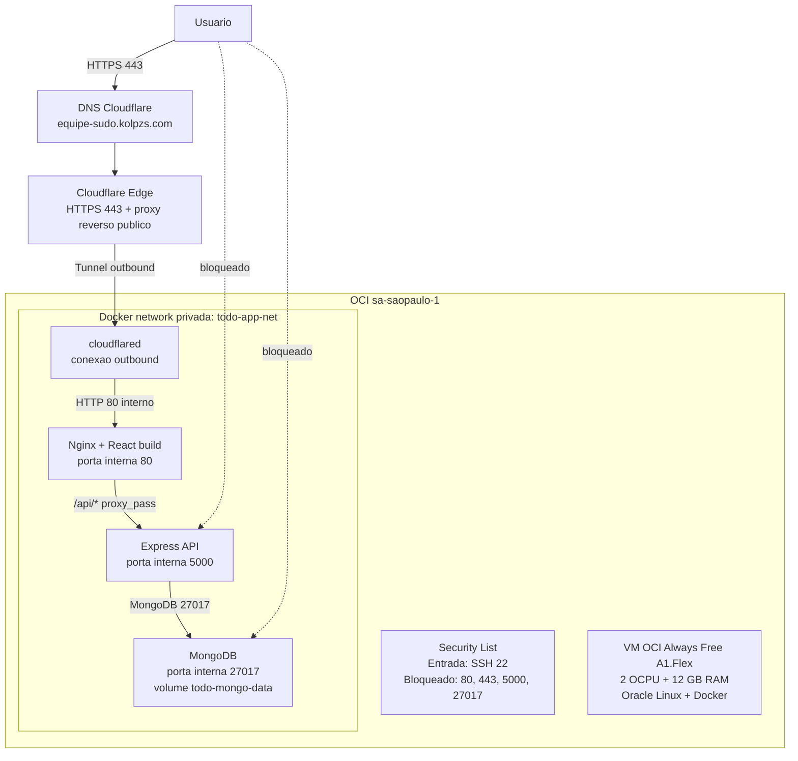

# Arquitetura Cloud - Equipe SUDO

> Aplicacao Todo App do fork `equipe-sudo/aula-uniamerica-infraestrutura-cloud`

## Diagrama



## Componentes

| Componente | Tecnologia | Porta | Exposicao |
|---|---|---:|---|
| DNS e HTTPS | Cloudflare | 443 | Publico |
| Proxy reverso publico | Cloudflare Tunnel | 443 externo | Publico via dominio |
| Proxy reverso interno | Nginx no container frontend | 80 | Apenas rede Docker |
| Front-end | React build estatico servido por Nginx | 80 | Apenas via tunnel |
| Back-end | Node.js + Express | 5000 | Apenas rede Docker |
| Banco de dados | MongoDB | 27017 | Apenas rede Docker |
| Firewall | OCI Security List | 22 inbound | Bloqueia acesso direto a app e DB |

## Fluxos permitidos

| Origem | Destino | Protocolo/porta | Motivo |
|---|---|---:|---|
| Usuario | Cloudflare | HTTPS 443 | Acesso publico ao dominio |
| Cloudflare Edge | cloudflared | QUIC/HTTPS outbound | Entrada pelo tunnel sem porta publica na VM |
| cloudflared | frontend | HTTP 80 | Entrega do front-end |
| frontend Nginx | backend | HTTP 5000 | Proxy reverso para `/api/*` |
| backend | MongoDB | TCP 27017 | Persistencia das tarefas |
| Administrador | VM | SSH 22 | Operacao e troubleshooting |

## Fluxos bloqueados

| Origem | Destino | Porta | Bloqueio |
|---|---|---:|---|
| Internet | frontend direto na VM | 80/443 | OCI Security List nao libera portas web |
| Internet | backend direto | 5000 | Sem porta publicada no Docker e sem regra OCI |
| Internet | MongoDB direto | 27017 | Sem porta publicada no Docker e sem regra OCI |
| frontend | MongoDB | 27017 | Front-end nao esta na cadeia de acesso ao banco |

## Rotas

```text
Usuario -> https://equipe-sudo.kolpzs.com
  -> Cloudflare DNS/HTTPS
  -> Cloudflare Tunnel
  -> frontend:80
  -> arquivos estaticos React

Frontend -> /api/todos
  -> Nginx location /api/
  -> backend:5000/todos
  -> mongo:27017/todo-app
```

## Observacao sobre serverless

A arquitetura em execucao usa uma VM OCI Always Free A1.Flex dimensionada com o limite gratuito disponivel no tenancy: 2 OCPU e 12 GB RAM, containers Docker e Cloudflare Tunnel. Ela atende isolamento, dominio, HTTPS, proxy reverso e bloqueio de acesso direto ao back-end e banco.

O ponto de atencao e que VM com containers nao e serverless no sentido estrito. Para a entrega academica, a defesa tecnica e que a OCI esta sendo usada como camada cloud isolada, automatizada e protegida, com entrada serverless/gerenciada pelo Cloudflare Tunnel. Se a avaliacao exigir serverless literal para todos os componentes, a evolucao recomendada e migrar o front-end para Cloudflare Pages e o banco para MongoDB Atlas Serverless ou outro banco gerenciado, mantendo o back-end em uma plataforma serverless compativel.
