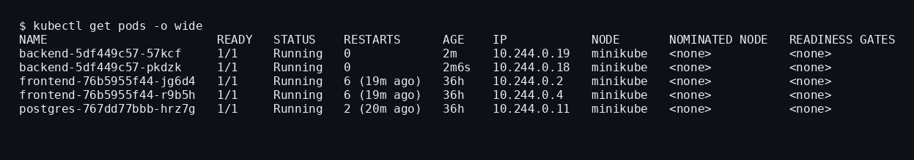
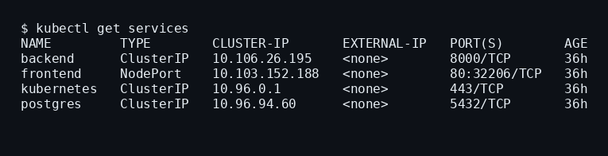
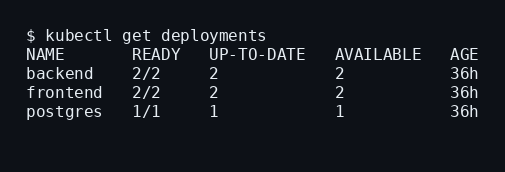
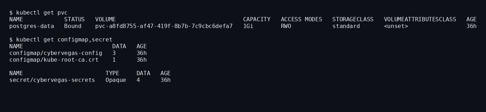
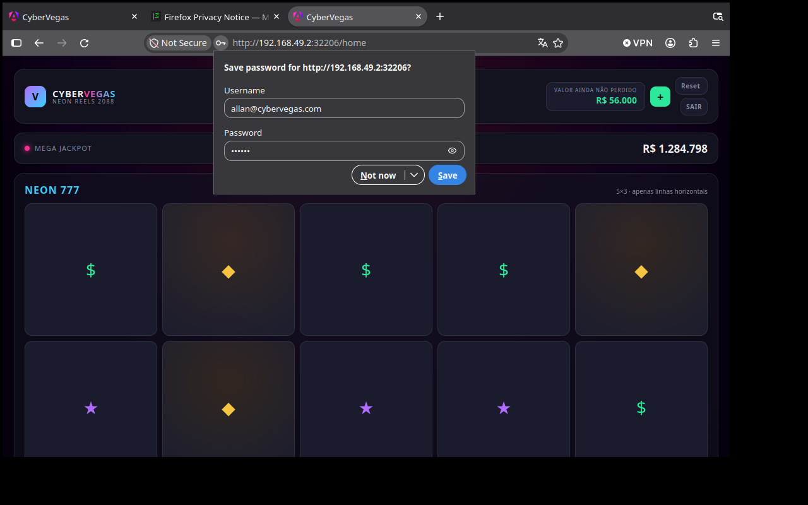
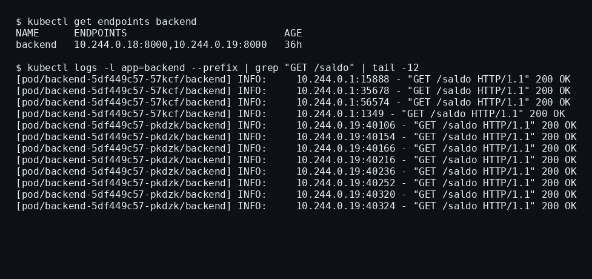
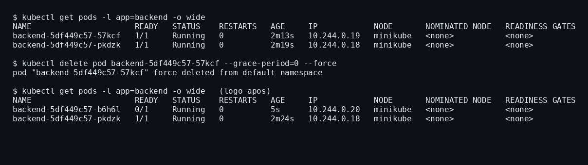

# Evidências — CyberVegas no Kubernetes (Minikube) + ArgoCD

**Entrega 03** · Equipe SUDO · Ambiente: Minikube local (driver Docker)

Capturas reais do cluster e da aplicação em execução, tiradas no mesmo momento
(nomes e IPs dos Pods consistentes entre as seções).

---

## 1. Pods em execução — `kubectl get pods -o wide`



5 Pods rodando: **2 réplicas** do `backend`, **2 do `frontend`** e 1 `postgres`.

## 2. Services — `kubectl get services`



- `frontend` → **NodePort** (`80:32206`), exposto ao navegador.
- `backend` e `postgres` → **ClusterIP** (acessíveis só dentro do cluster).

## 3. Deployments — `kubectl get deployments`



`backend` 2/2, `frontend` 2/2, `postgres` 1/1.

## 4. Persistência + ConfigMap/Secret



- `postgres-data` (**PVC** de 1 Gi) — os dados sobrevivem à recriação do Pod.
- `cybervegas-config` (**ConfigMap**) e `cybervegas-secrets` (**Secret**).

## 5. Aplicação em execução (logada)

Acessada pelo **NodePort do Minikube** (`http://192.168.49.2:32206`), logada com o
usuário padrão — a barra de endereço mostra o IP do nó e o NodePort:



```
GET /api/           → {"status":"online","mensagem":"Cyber Vegas API está no ar 🎰","versao":"1.1.0"}
GET /api/saldo      → {"saldo":56000.0,"mensagem":"Saldo consultado com sucesso."}
GET /health         → {"status":"ok"}
GET /health/ready   → {"status":"ready","database":"connected"}
```

O `database:"connected"` prova que o backend está no **PostgreSQL** (não no
fallback SQLite).

## 6. Balanceamento de carga entre os 2 Pods



O Service `backend` tem **2 endpoints** (`10.244.0.18:8000` e `10.244.0.19:8000`,
que batem com os IPs dos Pods da seção 1). O trecho do log
(`kubectl logs -l app=backend --prefix`) mostra as requisições `GET /saldo`
chegando **aos dois Pods** (`backend-...-57kcf` e `backend-...-pkdzk`) — round-robin
do kube-proxy.

## 7. Recriação automática de um Pod



Deletado **um** Pod por nome (`backend-5df449c57-57kcf`). O Deployment criou
imediatamente um substituto (`backend-5df449c57-b6h6l`, IP novo `10.244.0.20`),
reestabelecendo as 2 réplicas sem intervenção.

## 8. ArgoCD — GitOps

```
$ kubectl -n argocd get application cybervegas
NAME         SYNC STATUS   HEALTH STATUS
cybervegas   Synced        Healthy
```

---

## Comandos usados (resumo)

```bash
minikube start --driver=docker
minikube image build -t cybervegas-backend:latest  ../backend
minikube image build -t cybervegas-frontend:latest ../frontend

cd kubernetes && terraform init && terraform apply

kubectl get pods -o wide
kubectl get services
kubectl get deployments
kubectl get endpoints backend
kubectl delete pod <nome-de-um-pod>   # apaga UM pod (não -l app=backend)
```

> O endereço `192.168.49.2` é o IP do nó do Minikube e `32206` é o NodePort do
> Service `frontend` — prova de que a aplicação é acessada pelo Kubernetes.
