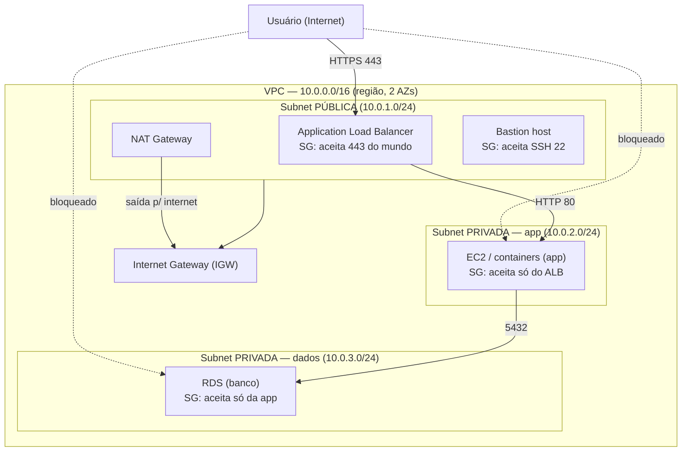

# Seminário — Redes e Isolamento na AWS (VPC, Subnets, Security Groups, NAT Gateway)

> **Tema escolhido:** #7 — Redes e isolamento na AWS
> **Serviços:** VPC, Subnets, Security Groups, NAT Gateway
> **Equipe:** João, Fernanda, Allan e Thiago
> **Tempo:** 20 min (cerca de 3 min por pergunta + abertura/encerramento)

---

## Por que este tema

Este tema mapeia diretamente para a infraestrutura real da equipe na Oracle Cloud (OCI): o que chamamos de **VCN** na OCI é o **VPC** da AWS; a **subnet** e o **Security List** têm equivalentes diretos. Isso torna a explicação didática e permite demonstrar o conteúdo na prática usando o ambiente que já roda hoje.

### Tabela de equivalência (AWS ↔ OCI — nosso projeto)

| Conceito | AWS | OCI (o que já usamos) |
|---|---|---|
| Rede virtual isolada | **VPC** (Virtual Private Cloud) | **VCN** `vcn-equipe-sudo-dev` |
| Bloco de endereços IP | CIDR `10.0.0.0/16` | CIDR `10.0.0.0/16` |
| Subdivisão da rede | **Subnet** (pública / privada) | **Subnet** `sn-equipe-sudo-public-dev` |
| Porta de saída para a internet | **Internet Gateway (IGW)** | Internet Gateway `igw-equipe-sudo-dev` |
| Firewall por recurso (stateful) | **Security Group (SG)** | Network Security Group (NSG) |
| Firewall por sub-rede (stateless) | **Network ACL (NACL)** | **Security List** (o que usamos) |
| Saída de sub-rede privada para a internet | **NAT Gateway** | NAT Gateway |

> **Atenção didática:** o "Security List" da OCI não é igual ao "Security Group" da AWS. O Security List da OCI é um firewall **por sub-rede e stateless** (equivale ao NACL da AWS), enquanto o Security Group da AWS é **por recurso e stateful**. Vamos usar essa comparação para ensinar a diferença entre firewall stateful e stateless.

---

## Pergunta 1 — Qual problema esse serviço resolve?

**Responsável: João**

### O problema

Quando você sobe recursos na nuvem (máquinas, bancos, containers), eles precisam conversar entre si e, às vezes, com a internet. Sem uma camada de rede controlada, acontece o "caos de rede":

- Tudo fica exposto e qualquer um pode acessar qualquer coisa.
- Não dá para saber quem fala com quem, em qual porta, de onde.
- Banco de dados e back-end ficam acessíveis pela internet, virando alvo de ataque.

### O que o VPC (e amigos) resolve

O **VPC** cria uma **rede privada virtual isolada** dentro da AWS: um "condomínio" só seu, onde você é o dono do endereçamento, do roteamento e dos filtros.

Resolve três necessidades:

1. **Isolamento lógico** — seus recursos vivem numa rede separada, invisível para os outros clientes da AWS.
2. **Segmentação** — você divide a rede em sub-redes **públicas** (falam com a internet) e **privadas** (não são alcançáveis da internet).
3. **Controle fino de acesso** — com **Security Groups** e **NAT Gateway**, você decide exatamente qual tráfego entra e qual sai.

### Analogia didática (para alunos e professores)

Imagine um **prédio** (o VPC) com **apartamentos** (as sub-redes). Alguns apartamentos têm **varanda** (subnet pública, com porta para a rua via Internet Gateway); outros não têm (subnet privada). A **portaria** (Security Group) decide quem pode entrar. O **NAT Gateway** é como o porteiro que liga para fora e pede uma pizza (tráfego de saída) sem deixar ninguém da rua entrar.

### Conexão com nosso projeto

Na OCI, o mesmo problema existia: nossa VM, nosso back-end e nosso MongoDB precisavam ficar **isolados** da internet. Nós resolvemos exatamente isso com VCN + subnet + Security List, deixando abertas só as portas necessárias (SSH 22) e bloqueando o resto.

---

## Pergunta 2 — Como ele funciona?

**Responsável: Fernanda**

### Os 4 blocos que compõem a rede

**1. VPC (Virtual Private Cloud)**
- Rede lógica isolada, definida por um bloco de IP (CIDR), ex: `10.0.0.0/16` (até 65.536 IPs).
- Vive numa região e pode se estender por múltiplas **Zonas de Disponibilidade (AZs)**.

**2. Subnets**
- Subdivisões do bloco da VPC. Ex: `10.0.1.0/24` (até 256 IPs).
- Cada subnet fica numa AZ.
- **Pública:** tem rota para a Internet Gateway → alcançável da internet.
- **Privada:** não tem rota direta para a internet → protegida.

**3. Gateways de roteamento**
- **Internet Gateway (IGW):** a "porta da frente" — conecta a subnet pública à internet (entrada e saída).
- **NAT Gateway:** a "porta dos fundos, só de saída" — deixa a subnet privada acessar a internet (ex: baixar atualizações) **sem** permitir que a internet a acesse. Fica na subnet pública.

**4. Firewalls**
- **Security Group (SG):** firewall **stateful** atrelado a cada recurso. Controla tráfego por porta, protocolo e origem. Como é stateful, se você libera a saída, a resposta entra automaticamente.
- **Network ACL (NACL):** firewall **stateless** no nível da subnet. Como é stateless, você precisa liberar entrada E saída separadamente.

### Como o tráfego é decidido (passo a passo)

```
1. Um pacote chega a um recurso.
2. O roteamento (Route Table) define por qual gateway/subnet ele segue.
3. O NACL da subnet filtra (stateless).
4. O Security Group do recurso filtra (stateful).
5. Se passar por tudo, o pacote chega ao destino.
```

### Resumo em uma frase

> VPC define o "terreno", subnets dividem os "cômodos", gateways controlam a entrada/saída, e Security Groups/NACL são os filtros que decidem quem passa.

---

## Pergunta 3 — Como seria uma arquitetura utilizando esse serviço?

**Responsável: Allan**

### Arquitetura clássica de 3 camadas (com isolamento)



### Como cada camada fica isolada

| Camada | Onde fica | Quem pode acessar |
|---|---|---|
| Load balancer / bastion | Subnet pública | Internet (porta 443 / SSH 22) |
| Aplicação | Subnet privada | Somente o load balancer |
| Banco de dados | Subnet privada | Somente a aplicação |

### Regras de Security Group (exemplo)

| Security Group | Porta | Origem | Efeito |
|---|---|---|---|
| SG-ALB | 443 | 0.0.0.0/0 (internet) | Público acessa o site |
| SG-APP | 80 | SG-ALB | Só o load balancer chega na app |
| SG-DB | 5432 | SG-APP | Só a app chega no banco |

### Conexão com nosso projeto (paralelo direto)

A nossa arquitetura na OCI faz exatamente a mesma coisa, só que em escala menor (1 VM):

- **VPC → VCN** (`vcn-equipe-sudo-dev`)
- **Subnet pública → subnet** (`sn-equipe-sudo-public-dev`)
- **Internet Gateway → Internet Gateway** (`igw-equipe-sudo-dev`)
- **Security Group/NACL → Security List** (SSH 22 aberto, resto bloqueado)
- A entrada web não usa portas abertas: entra pelo **Cloudflare Tunnel** (conexão outbound), então a VM não precisa expor 80/443/5000/27017.

---

## Pergunta 4 — Quais as vantagens e limitações?

**Responsável: Thiago**

### Vantagens

| Vantagem | Explicação |
|---|---|
| **Isolamento total** | Cada VPC é uma rede separada; seus recursos não aparecem para outros clientes. |
| **Defesa em profundidade** | Várias camadas (subnet, NACL, SG) — se uma falha, as outras seguram. |
| **Controle granular** | Security Group stateful por recurso: regra por porta, protocolo e origem. |
| **Segmentação lógica** | Sub-redes públicas/privadas separam o que é exposto do que é protegido. |
| **Privacidade de dados** | Banco e back-end ficam em sub-rede privada, sem IP público. |
| **Saída segura (NAT)** | Sub-rede privada acessa a internet para atualizar, sem ser alcançável. |
| **Integração e auditoria** | Funciona com VPC Flow Logs (registra todo o tráfego para análise). |
| **Escalável** | A mesma VPC cresce de 1 a centenas de recursos sem redescarregar nada. |

### Limitações

| Limitação | Explicação |
|---|---|
| **Curva de aprendizado** | Rotas, subnets, NACL e SG exigem entender conceitos de rede. |
| **Limite de 5 VPCs por região** | Padrão da AWS (é possível aumentar, mas precisa pedir). |
| **NAT Gateway tem custo** | Cobra por hora + por GB processado (não é gratuito como o IGW). |
| **Fácil errar a configuração** | Uma regra de SG errada (porta errada, origem 0.0.0.0/0) pode vazar acesso. |
| **Stateful pode confundir** | No SG, se você libera a saída, a resposta entra sozinha — quem não sabe pode abrir mais do que imagina. |
| **Troubleshooting complexo** | "Por que o pacote não chega?" pode envolver rota + NACL + SG ao mesmo tempo. |

### Resumo

> É o "cinturão de segurança" da nuvem: poderoso e flexível, mas exige cuidado na configuração — um erro simples pode anular todo o isolamento.

---

## Pergunta 5 — Demonstração / exemplo prático

**Responsável: João**

### O que demonstrar (na OCI, ambiente real da equipe)

Nosso projeto já comprova na prática os mesmos conceitos de rede e isolamento da AWS. Vamos mostrar:

**1. A rede isolada (VCN = VPC)**
- Abrir o console da OCI e mostrar a VCN `vcn-equipe-sudo-dev`, a subnet `sn-equipe-sudo-public-dev` e o Internet Gateway.

**2. O firewall (Security List = NACL/SG)**
- Mostrar que só a porta **SSH 22** está liberada de entrada.
- As portas **80, 443, 5000 e 27017 estão bloqueadas**.

**3. Prova do isolamento (testes ao vivo)**

```bash
# 1. Site acessível (entra pelo Cloudflare Tunnel — sem porta aberta na VM)
curl -I https://equipe-sudo.kolpzs.com
# → 200 OK

# 2. Back-end direto: DEVE falhar (bloqueado pelo Security List)
curl -m 5 http://129.148.50.233:5000/health
# → timeout / connection refused

# 3. Banco direto: DEVE falhar (bloqueado)
curl -m 5 http://129.148.50.233:27017
# → timeout / connection refused
```

**4. A tradução para AWS**

Ao final, mostrar que, se fosse na AWS, seria a mesma lógica:

| OCI (demonstrado) | AWS (equivalente) |
|---|---|
| VCN + subnet | VPC + Subnets |
| Security List (SSH 22 aberto) | Security Group / NACL |
| Portas 80/443/5000/27017 bloqueadas | SGs liberando só o necessário |
| Cloudflare Tunnel (saída) | NAT Gateway / IGW controlado |

### Roteiro da demo (3 min)

1. (30s) Abrir console e apontar VCN/subnet/firewall.
2. (1min) Rodar `curl` no site (funciona) e no back-end/banco (falha).
3. (1min) Explicar que é o mesmo princípio do Security Group da AWS.
4. (30s) Fechar dizendo: "rede bem configurada = só o necessário acessível".

> **Detalhamento completo da demo** (pré-flight, comandos com saída esperada, plano B com
> screenshots e dicas de apresentação): ver `04-demonstracao.md`.

---

## Divisão da apresentação

| Ordem | Pessoa | Parte | Perguntas | Tempo |
|---|---|---|---|---|
| 1 | **João** | Abertura + P1 | 1 (problema) | ~3 min |
| 2 | **Fernanda** | P2 | 2 (como funciona) | ~3 min |
| 3 | **Allan** | P3 | 3 (arquitetura) | ~3 min |
| 4 | **Thiago** | P4 | 4 (vantagens/limitações) | ~3 min |
| 5 | **João** | P5 + encerramento | 5 (demonstração) | ~3 min |
| — | (buffer) | Transições + perguntas | — | ~5 min |

> Total: ~15 min de conteúdo + ~5 min de buffer = 20 min.
> João abre e fecha a apresentação (P1 e P5).
